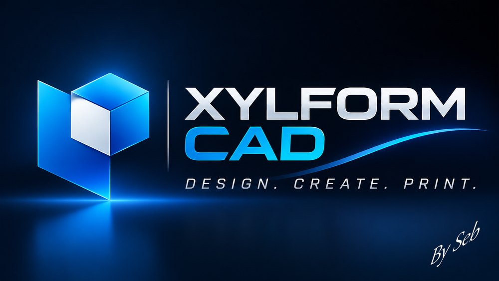

<p align="center"></p>

# Xylform CAD, by Seb.

Logiciel libre de CAO 2D/3D pour l'impression 3D, à l'ergonomie des logiciels de CAO classiques : application
Windows (.exe) ou dans le navigateur. Noyau B-rep **OpenCascade** (WebAssembly), rendu **Three.js**,
interface **React**, lecture **DWG** (LibreDWG), lecture/écriture **DXF** et **STEP**, **fonds de
plan** DWG/DXF/PDF/images, export **STL** et **3MF** avec contrôle d'imprimabilité, visserie à
filetage réel, charnières imprimables, raccords PVC…

Licence **MIT** (voir [LICENSE](LICENSE)). Nouveautés : [CHANGELOG.md](CHANGELOG.md).

## Télécharger (Windows)

Dernière version : <https://github.com/Seb59181/XYLFORM-CAD/releases/latest>

- **Installateur** `Xylform-CAD-Setup-x.y.z.exe` (conseillé) : choix du dossier, raccourcis Bureau
  et menu Démarrer, désinstallation par Paramètres › Applications. Les dessins `.xcad` (et les
  anciens `.sebcad`) s'ouvrent par double-clic. **Se met à jour tout seul.**
- **Portable** `Xylform-CAD-x.y.z-portable.exe` : se lance sans installation ; il signale les
  nouvelles versions mais ne se remplace pas lui-même.

> Tant que l'exe n'est pas signé numériquement, Windows peut afficher « Windows a protégé votre
> ordinateur » : **Informations complémentaires** puis **Exécuter quand même**. La signature gratuite
> des projets libres par SignPath Foundation est en cours de demande (voir plus bas).

Dans la version bureau, `Ctrl+S` réécrit directement le fichier ouvert, les exports ouvrent la boîte
« Enregistrer sous » de Windows, et la fermeture demande confirmation si un dessin n'est pas enregistré.
À la première ouverture, les réglages d'une ancienne installation de SebCad sont repris.

### Mise à jour automatique

Au démarrage, la version installée lit la dernière version publiée sur GitHub (fichier `latest.yml`
de la Release). Si elle est plus récente, Xylform CAD propose de la télécharger, puis de redémarrer
pour l'installer (ou de l'installer à la fermeture). Après la mise à jour, l'écran **Quoi de neuf**
résume les nouveautés (tirées de `CHANGELOG.md`), une seule fois.

- `MISEAJOUR` : vérifier maintenant, ou activer / couper la vérification au démarrage ;
- `QUOIDENEUF` : réafficher les nouveautés (aussi sur la page Démarrage).

### Publier une nouvelle version (mainteneur)

1. Monter `"version"` dans `package.json` et ajouter la section `## x.y.z — date` en tête de
   `CHANGELOG.md` (c'est elle qu'affiche « Quoi de neuf »).
2. Construire les exe (`creer-exe.bat`), puis sur GitHub : **Releases › Draft a new release**,
   étiquette `vx.y.z`, et déposer les 4 fichiers du dossier `release\` **sans les renommer** :
   `Xylform-CAD-Setup-x.y.z.exe`, `Xylform-CAD-Setup-x.y.z.exe.blockmap`,
   `Xylform-CAD-x.y.z-portable.exe` et **`latest.yml`** (indispensable à la mise à jour
   automatique). Cocher « Set as the latest release », publier.
3. Ou bien : onglet **Actions › Release › Run workflow**, case « Publier » cochée : GitHub compile
   sous Windows, fait signer par SignPath (si configuré) et publie la Release lui-même.

### Signature du code (SignPath Foundation)

Xylform CAD est candidat au programme gratuit de [SignPath Foundation](https://signpath.org) pour
les logiciels libres. Une fois le projet accepté, renseigner dans le dépôt (Settings › Secrets and
variables › Actions) :

| Nom | Type | Valeur |
|---|---|---|
| `SIGNPATH_API_TOKEN` | secret | jeton API de l'utilisateur CI SignPath |
| `SIGNPATH_ORGANIZATION_ID` | variable | identifiant de l'organisation SignPath |
| `SIGNPATH_PROJECT_SLUG` | variable | `xylform-cad` (slug du projet chez SignPath) |
| `SIGNPATH_POLICY_SLUG` | variable | `release-signing` |

Sans ces réglages, le workflow publie des exe non signés.

### Générer l'exe vous-même

Double-cliquez sur **`creer-exe.bat`** (Node.js 22 LTS requis). Il installe les dépendances puis crée
l'installateur et la version portable dans le dossier `release\`. En ligne de commande :

```powershell
npm.cmd install
npm.cmd run exe        # → release\Xylform-CAD-Setup-x.y.z.exe et release\Xylform-CAD-x.y.z-portable.exe
npm.cmd run desktop    # essai de la version bureau sans créer d'exe
```

L'icône est `build/icon.ico` ; le logo, `public/logo-xylform.jpg`.

## Lancer dans le navigateur (Windows)

Prérequis : **Node.js 22 LTS** (ou 20.19+) — <https://nodejs.org>.

**Le plus simple :** double-cliquez sur `lancer-xylform.bat`.
La première fois, il installe les dépendances (quelques minutes), puis il ouvre Xylform CAD
dans votre navigateur à l'adresse <http://localhost:5173>. Laissez la fenêtre noire ouverte
pendant que vous travaillez ; fermez-la pour arrêter le logiciel.

**En ligne de commande** (PowerShell ou Invite de commandes, dans le dossier du projet) :

```powershell
npm.cmd install      # une seule fois
npm.cmd run dev      # démarre Xylform CAD et ouvre le navigateur
```

> Dans PowerShell, `npm` peut être bloqué par la stratégie d'exécution (« l'exécution de scripts
> est désactivée sur ce système »). Utilisez `npm.cmd` comme ci-dessus, ou une fois pour toutes :
> `Set-ExecutionPolicy -Scope CurrentUser RemoteSigned`.

Navigateurs conseillés : Chrome ou Edge (enregistrement direct dans le fichier ouvert avec Ctrl+S).
Firefox fonctionne aussi (les fichiers sont alors téléchargés).

Version autonome (sans serveur de développement) : `npm.cmd run build` puis `npm.cmd run preview`
(<http://localhost:4173>). Le dossier `dist/` peut être hébergé sur n'importe quel serveur web statique.

## Prise en main en 2 minutes

| Pour… | Faites… |
|---|---|
| Dessiner une ligne | Tapez `L` puis Entrée (ou bouton **Ligne**), cliquez les points, Entrée pour finir |
| Saisir des coordonnées | `10,20` absolu · `@30,0` relatif · `@50<30` polaire · `50` = longueur dans la direction du curseur |
| Créer une boîte | `BOITE` → coin `0,0,0` → coin opposé `@60,40` → hauteur `25` |
| Percer un trou | `CYLINDRE` à travers la boîte, puis `SOUSTRACTION` : cliquez la boîte, Entrée, le cylindre, Entrée |
| Arrondir des arêtes | `RACCORDBORD` → `R` pour le rayon → cliquez les arêtes → Entrée |
| Extruder un contour | Dessinez un `RECTANGLE` ou une polyligne fermée, puis `EXTRUSION` |
| Exporter pour l'impression 3D | Onglet **Sortie** → **STL** ou **3MF** (qualité, unités, réparation, vérification d'étanchéité) |
| Ouvrir un DWG/DXF | `Ctrl+O` ou glissez-déposez le fichier dans la zone de dessin |
| Mettre un plan en fond | `ATTACHER` (ou onglet **Insertion › Attacher**) : DWG, DXF, PDF ou image, puis point d'insertion, échelle, rotation |
| Gérer les fonds de plan | `REFEXT` ou l'icône en haut à droite : charger/décharger, recharger, estomper, calques du fond, lier, détacher |
| Trouver une commande | `F1` (liste filtrable de toutes les commandes et raccourcis) |

Navigation : molette = zoom au curseur, bouton du milieu = panoramique, Maj + bouton du milieu = orbite,
double-clic molette = zoom étendu, cube de vue en haut à droite (clic sur une face, une arête ou un coin,
glisser pour tourner, maison = vue d'accueil). Échap annule la commande puis vide la sélection.
Entrée, Espace **ou un clic droit court** valident (et répètent la dernière commande sur une invite vide) ;
un clic droit **maintenu une demi-seconde** ouvre le menu contextuel (`CLICDROIT` pour changer la durée).

### Espaces de travail 2D et 3D

Le sélecteur **2D | 3D** de la barre de titre (ou `ESPACETRAVAIL`) change d'espace :

- **2D (dessin)** : vue de dessus en projection parallèle, orbite désactivée, onglets Solides / Surfaces /
  Outils 3D masqués, pas de cube de vue. Le noyau 3D OpenCascade (≈ 50 Mo de WebAssembly) **n'est pas chargé** :
  démarrage plus rapide et moins de mémoire. Il se charge tout seul si une commande 3D en a besoin.
- **3D (modélisation)** : tout le ruban, cube de vue, barre de navigation, outils.

### Outils 3D

| Outil | Commande | Usage |
|---|---|---|
| Appuyer/tirer | `APPUYERTIRER` (`PP`) | Cliquez une face plane d'un solide puis tirez (ajout) ou poussez (enlèvement) ; ou cliquez **à l'intérieur** d'un contour fermé : il est extrudé, joint au corps qu'il touche (vers l'extérieur) ou enlevé (vers l'intérieur) |
| Esquisse sur une face | `ESQUISSE` | Cliquez le dessus d'un solide : le plan de travail (grille, curseur) passe à sa hauteur et la vue se met de dessus. `ESQUISSE` › `Sol` pour revenir à Z = 0 ; `ELEV` pour une hauteur quelconque |
| Analyse de coupe | `ANALYSECOUPE` | Plan X, Y, Z ou parallèle à une face, à faire glisser ; coupe hachurée, solides intacts. `Inverser` / `Arrêt` |
| Navigateur | palette **Navigateur** | Corps, surfaces, esquisses par calque, fonds de plan ; œil pour masquer, clic pour sélectionner, double-clic pour renommer / cadrer |
| Masquer / isoler | `MASQUEROBJETS`, `ISOLER`, `AFFICHERTOUT` | Visibilité objet par objet, indépendante des calques |

### Bibliothèque de pièces

Palette **Pièces** (icône en haut à droite, bouton **Pièces** de l'onglet Solides ou commande `PIECES`) :
choisissez une pièce, remplacez ses cotes, puis **Insérer** et cliquez son point d'insertion dans la vue
(plusieurs poses possibles, Entrée pour terminer). Axe vertical ou horizontal (X, Y).

| Famille | Pièces |
|---|---|
| Visserie | Vis à tête hexagonale (ISO 4017), vis CHC (ISO 4762), écrou (ISO 4032), rondelle (ISO 7089), boulon complet (vis + rondelle + écrou), tige filetée, plaquette de calibration — tailles M3 à M20 préremplies ; filetage au choix : aucun (tige lisse) ou réel (hélice, impression 3D) ; un point d'interrogation explique Filetage, Usage et Jeu |
| Tubes et profilés | Tube rond, tube carré / rectangulaire, coude de tube (angle et rayon de cintrage), cornière, profilé en U |
| Formes | Boîte creuse (avec couvercle emboîtant en option), plaque percée, entretoise |
| Charnières | À lames (goupille séparée), à piano (continue), imprimable assemblée (print-in-place, jeu réglable), paumelle dégondable (mâle + femelle), à film (living hinge), flexible à fentes (kerf) — trous de vis droits ou fraisés, ouverture réglable |
| Plomberie (évacuation PVC) | Coudes 22°30, 45°, 67°30, 90° (87°30 en tapant l'angle), femelle/femelle ou mâle/femelle ; té 87°30/90° et té 45° (culotte), piquage réduit possible — tailles Ø32 à Ø125 (paroi, emboîture et jeu préremplis, modifiables) |

Les charnières à plusieurs éléments donnent un solide par pièce (lames, axe), sans contact entre
elles : on peut les exporter ensemble en STL/3MF et les imprimer déjà montées.

**Création 3D plus rapide** : les étapes intermédiaires d'une pièce ne sont plus maillées (seule la
forme finale l'est), puis libérées de la mémoire du noyau ; déplacer ou faire pivoter un solide ne
recopie plus sa géométrie et réutilise son maillage ; volume et contrôles ne sont plus calculés deux
fois. Exemple : vis H M8 à filetage réel insérée en ≈ 13 s au lieu de ≈ 20 s.

### Impression 3D : vis, trous et calculs longs (1.10)

- **Jeu des filetages par côté** : le jeu d'une empreinte de vis, d'un écrou ou d'un `PERCAGE` taraudé
  est mesuré perpendiculairement aux flancs du filet (0,2 mm par défaut, plafonné à 0,2 × pas pour
  qu'il reste un filet). Avant, agrandir le Ø ne laissait que le quart du jeu sur les flancs.
- **Plaquette de calibration** (Pièces › Visserie) : trous taraudés à jeux croissants (1 à 8 points
  gravés) et trous lisses Ø4 à Ø12. Imprimez-la avec une vis « Pièce », gardez le jeu du trou qui
  visse sans forcer ; mesurez les trous lisses pour la compensation.
- **Compensation des trous** (`COMPTROU` ou `OPTIONS`) : agrandit les nouveaux trous de passage,
  lamés, fraisés et les trous des pièces (FDM : les trous sortent trop petits). Modifiable ensuite
  dans l'historique.
- **Filetage réel à l'export** (`MODEFILETAGE`) : par défaut, les filetages réels sont dessinés en
  aperçu cosmétique (1 à 2 s) et le filet exact est calculé à l'export STL / 3MF / STEP.
  `FILETAGEREEL` le calcule tout de suite.
- **Échap arrête vraiment un calcul 3D** (ou bouton **Arrêter** de la barre d'état) : le noyau est
  relancé en quelques secondes et les solides rechargés depuis une copie de secours tenue à jour
  en tâche de fond ; seul l'historique d'annulation est perdu.

### Plusieurs dessins en onglets et agencement de l'interface (2.0)

- **Onglets des dessins** sous le ruban : **Démarrage**, un onglet par dessin ouvert (astérisque si
  modifié, croix pour fermer), bouton **+** pour un nouveau dessin, menu ☰ des dessins ouverts.
  `NOUVEAU` (Ctrl+N) et `OUVRIR` (Ctrl+O) ouvrent un nouvel onglet ; un fichier déjà ouvert est
  simplement affiché. Clic milieu ou Ctrl+F4 : fermer (Enregistrer / Ne pas enregistrer / Annuler) ;
  Ctrl+Tab et Ctrl+Maj+Tab : dessin suivant / précédent ; glisser un onglet pour le déplacer ;
  clic droit : enregistrer, fermer les autres, copier le chemin. `FERMER`, `FERMERTOUT`, `ENREGTOUT`.
  Chaque dessin garde sa vue, sa sélection, son plan de travail et son historique d'annulation ;
  copier / coller fonctionne d'un dessin à l'autre.
- **Page Démarrage** (`DEMARRAGE`) : nouveau dessin, ouvrir, dessins ouverts, **dessins récents**
  (rouverts directement par leur chemin dans la version Windows) et copies de secours.
- **Fenêtres de vue** (`FENETRES`, Vue › Interface ou icône de la barre d'état) : 1, 2, 3 ou 4 vues
  du même dessin (Dessus, Face, Droite, iso…). On dessine dans la vue encadrée en bleu ; un clic dans
  une autre vue la rend active (les deux vues s'échangent). Molette : zoom, glisser : orbite,
  double-clic : zoom étendu, menu [+] : choisir la vue.
- **Barre d'état** : onglets **Objet** et mises en plan (un clic cadre la feuille, **+** lance
  `MISEENPLAN`), menu ☰ pour choisir les boutons affichés, **écran épuré** (Ctrl+0 ou
  `ECRANEPURE`) qui masque ruban et onglets.
- La **sauvegarde automatique** garde une copie de secours par dessin ouvert ; au redémarrage après
  un plantage, chaque dessin est récupéré dans son onglet.

### Contrôle d'imprimabilité (1.11)

Avant chaque export STL / 3MF (case cochée par défaut), et à la demande avec `IMPRIMABILITE`
(onglet Sortie › Impression 3D) :

- **solides qui se chevauchent** : signalés, et fusionnés pour l'export si vous l'acceptez (le dessin
  n'est pas modifié) ;
- **parois trop fines** (0,8 mm par défaut) en orange et **porte-à-faux** de plus de 45° en rouge
  dans la vue ; les faces posées sur le plateau ne comptent pas ;
- l'unité proposée est celle du dessin ; le fichier est toujours écrit en millimètres.

### Menu du clic droit long

Répéter, Commandes récentes ›, Effacer / Déplacer / Copier / Échelle / Pivoter /
Miroir, Ordre de tracé › (`ORDRETRACE`), Presse-papiers › (couper, copier, copier avec point de base,
coller, coller aux coordonnées d'origine), Isoler ›, Annuler / Rétablir, Panoramique, Zoom ›, Vues ›,
Sélectionner similaire (`SELECTSIMILAIRE`), Sélection rapide (`SELECTRAPIDE`), Rechercher / remplacer
(`RECHERCHER`), Propriétés, Options (`OPTIONS`). Pendant une commande : Entrée, Annuler, options de la
commande, aides au dessin.

### Palettes détachables

Le bouton ⧉ de la barre d'onglets (ou un double-clic dessus) détache la palette : elle flotte dans la
vue, se déplace en glissant sa barre d'onglets et se redimensionne par son coin. Même bouton pour la
ré-ancrer à droite. La position est mémorisée.

Sur l'onglet **Propriétés**, le bouton ⧉ détache les Propriétés seules dans une fenêtre libre, posée
sur le dessin et déplaçable ; la palette latérale garde les autres onglets.
Ctrl+1 ouvre / ferme cette fenêtre ; son bouton ◧ (ou un double-clic sur son titre) la rattache.

### Primitives modifiables et splines fermées

- Boîte, cylindre, cône, sphère, pyramide et tore gardent leurs cotes : dans **Propriétés**, modifiez
  rayon, diamètre, hauteur, longueur, largeur, rayon supérieur, côtés… et le solide est reconstruit
  à sa place (même après DEPLACER / ROTATION / MIROIR). Une opération qui change la forme (union,
  congé, coque, appuyer/tirer…) ou une mise à l'échelle en fait un solide ordinaire.
- `SPLINE` : cliquez sur le premier point (accrochage Extrémité) ou tapez `C` (Clore) pour fermer la
  spline. Une spline fermée (ou refermée à la main) s'extrude en solide plein, comme une polyligne.

Exemple : `BOITE` 60×40×20 → `ESQUISSE` sur le dessus → `CERCLE` → `APPUYERTIRER`, clic dans le cercle,
`-12` → poche de 12 mm ; puis `APPUYERTIRER` sur une face latérale, `5` → la boîte s'allonge de 5 mm.

## Fonctions

- **Interface** : espaces de travail 2D (léger) et 3D, ruban à 9 onglets (Début, Insertion, Annoter, Paramétrique, Vue, Solides, Surfaces,
  Outils 3D, Sortie), barre d'accès rapide, ligne de commande flottante (autocomplétion, alias,
  historique F2, options cliquables, noms internationaux `_LINE`, commandes transparentes `'ZOOM`),
  saisie dynamique près du curseur, menus contextuels, palettes Propriétés / Calques / Paramètres / Fonds de plan,
  barre d'état (GRILLE, RESOL, ORTHO, POLAIRE, ACCROBJ, DYN, EP).
- **Vue** : perspective ou parallèle, vues standard et isométriques animées, cube de vue (26 directions,
  orbite par glisser), barre de navigation, analyse de coupe hachurée, grille adaptative
  infinie, icône SCU, styles visuels Réaliste / Ombré / Filaire / Rayons X.
- **Dessin 2D** : ligne, polyligne (segments et arcs), cercle (centre/rayon, 2P, 3P, TTR), arc, rectangle,
  polygone, ellipse, spline, point, hachures (motifs, plein, dégradé, îlots), texte, cotes (alignée,
  linéaire, rayon, diamètre).
- **Modification** : déplacer, copier, rotation, miroir, échelle, étirer, ajuster, prolonger, coupure,
  raccord, chanfrein, décaler, joindre, décomposer, diviser, réseaux rectangulaire et polaire, effacer,
  poignées (étirement), copier/coller entre dessins, correspondance des propriétés.
- **Aides au dessin** : accrochage aux objets (extrémité, milieu, centre, quadrant, intersection,
  nodal, insertion, perpendiculaire, tangente, proche), ortho, repérage polaire, résolution de grille.
- **Fonds de plan** (références externes) : `ATTACHER` un DWG, DXF, PDF
  (page au choix, taille réelle) ou une image (PNG, JPEG…) ; affichage estompé et non modifiable,
  accrochage aux objets du fond (extrémité, milieu, centre, intersection…), conversion d'unités
  automatique ($INSUNITS), palette **Fonds de plan** (`REFEXT`) : charger / décharger, recharger
  (depuis le fichier d'origine dans la version bureau), changer de fichier, renommer, zoom, estompage,
  monochrome, adaptation des couleurs au fond sombre, visibilité des calques du fond, **Lier**
  (convertit en objets du dessin) et **Détacher**. `ESTOMPAGE` (XDWGFADECTL) règle tous les fonds.
  Les fonds sont enregistrés dans le `.xcad` (le dessin reste lisible si le fichier source a bougé).
  Glisser-déposer d'un PDF ou d'une image = attacher.
- **Calques** : couleur TrueColor, épaisseur de ligne, activé, gelé, verrouillé, renommage, calque courant,
  états de calque (enregistrer / restaurer).
- **Paramétrique** : contraintes géométriques (coïncidence, horizontal, vertical, parallèle,
  perpendiculaire, tangente, concentrique, égal, fixe), contraintes automatiques, cotes pilotées
  avec expressions (`largeur/2+5`), paramètres utilisateur, degrés de liberté restants.
- **Solides** : boîte, cylindre, cône, sphère, pyramide, tore, extrusion (hauteur, direction, trajectoire,
  dépouille), révolution, balayage, lissage, hélice, union, soustraction, intersection, raccord et chanfrein
  d'arêtes (rayon constant ou variable), coque, coupe, épaissir, appuyer/tirer (faces planes et contours),
  esquisse sur une face, déplacer/rotation/miroir 3D,
  vérification de solide, propriétés de masse, **texte 3D** (`TEXTE3D` : posé, gravé ou embossé sur une
  face, polices Droid avec accents).
- **Historique paramétrique** (une chronologie des opérations) : chaque corps garde ses étapes
  (primitive, extrusion, révolution, congé, chanfrein, coque, appuyer/tirer, perçage, booléens avec
  l'historique des corps soustraits, texte gravé, déplacements). Dans Propriétés › Historique, modifier
  une cote rejoue tout ; une étape peut être supprimée temporairement (●/○) ou retirée (✕). Une cote
  peut être une expression liée aux paramètres utilisateur (`ep*2`) : changer le paramètre reconstruit
  le corps. Le Navigateur affiche les étapes sous chaque corps.
- **Perçage** (`PERCAGE`) : trous de passage, lamés (ISO 4762), fraisés à 90° (ISO 10642), taraudés
  (avant-trou, filetage réel en option) ou logements d'inserts à chaud, M3 à M20, borgnes ou débouchants,
  plusieurs trous à la fois sur une face plane (accrochages aux centres, milieux…).
- **Sauvegarde automatique** (`TEMPSSAUV`, 5 min par défaut) : copie de secours du dessin non
  enregistré ; après un plantage ou une coupure, Xylform CAD propose de la récupérer au démarrage
  (`RECUPDESSIN` pour la rouvrir à la main).
- **Écran de démarrage** : nom, version et étape du chargement (noyau 3D en pourcentage).
- **Mise en plan** (`MISEENPLAN`, onglet Sortie) : vues de face, dessus, gauche, droite, dessous,
  arrière et isométrique générées depuis la 3D (projection européenne ou américaine), lignes cachées
  en tirets, axes et centres des perçages, cadre A4 à A0 avec cartouche (titre, matière, échelle, date,
  symbole de projection), échelle automatique. Les vues sont en vraie grandeur : `COTLIN`, `COTALI`,
  `COTDIA`… donnent les vraies cotes. `MAJVUES` régénère les vues après une modification du modèle,
  `EXPORTPDF` imprime la feuille à l'échelle en PDF vectoriel (`EXPORTDXF` reste possible).
- **Types de ligne** : continu, caché, axe, tirets, fantôme par calque (palette Calques), échelle
  `LTSCALE`, conservés en DXF.
- **Tôlerie** (`TOLE`, `DEPLIER`, onglet Outils 3D) : tôle de base tirée d'un contour fermé, bords
  pliés sur les arêtes cliquées (angle, longueur extérieure, sens, rayon intérieur, facteur K, pli dans
  ou hors du contour) ; cliquer une tôle existante modifie ses bords, et toutes ces cotes restent
  modifiables dans l'historique. `DEPLIER` trace le développé (longueur développée par la fibre neutre),
  les lignes de pliage avec sens et angle, reporte les perçages et l'exporte en DXF pour la découpe.
- **Réseaux 3D** (`RESEAU3D`, `RESEAUCHEMIN`) : copies en grille X × Y × Z, en cercle autour d'un axe
  quelconque (avec ou sans rotation des objets) ou le long d'une courbe orientées sur sa tangente ;
  les solides gardent leur historique.
- **Rendu réaliste** : `MATERIAU` (acier, inox, aluminium, laiton, cuivre, PLA, PETG, bois, verre…),
  style visuel Rendu avec ombres portées, `RENDU` enregistre une image PNG jusqu'en 4K (fond studio,
  blanc ou transparent).
- **Personnaliser** (`PERSONNALISER`, onglet Vue) : raccourcis clavier sur mesure (Ctrl, Alt, Maj +
  touche ou F1 à F12 → n'importe quelle commande avec ses options) et onglet de ruban « Mon onglet »
  (clic droit sur un bouton du ruban → Ajouter à Mon onglet).
- **Ruban adaptatif** : jamais de barre de défilement ; quand la place manque, les groupes perdent
  leurs libellés puis des colonnes (commandes rangées sous le ▾ du titre du groupe), enfin se replient
  en un bouton. Groupes réorganisables par glisser-déposer de leur titre (clic droit sur le titre :
  déplacer à gauche / à droite, rétablir l'ordre), ordre mémorisé par onglet.
- **Entrée directe de distance** : pendant DEPLACER, COPIER, LIGNE…, orientez le curseur (axe X/Y/Z
  coloré, polaire, ortho) et tapez la distance au clavier puis Entrée.
- **Profils toujours plans** : pendant POLYLIGNE et SPLINE, les points restent à la hauteur du point
  précédent (pas d'axe Z, accrochage ramené dans le plan). À l'extrusion, un profil très légèrement
  gauche est aplani automatiquement ; sinon le message désigne le point hors plan ou l'endroit où la
  courbe se croise. `APLANIR` (`APL`) ramène des courbes à Z = élévation courante.
- **Manipulateur 3D** : flèches et anneaux sur la sélection pour déplacer / tourner
  à la souris ; un simple clic sur une poignée demande une valeur exacte (`GIZMO` dans la barre d'état).
- **Repérage 3D** : axes X/Y/Z colorés depuis le point de base,
  alignements sur les points survolés, accrochage « Sur la face » et au centre des arêtes circulaires.
- **Mètre 3D** (`MESUREGEOM`) : distance, angle entre faces, épaisseur d'une paroi, surface des faces.
- **Assemblages** : `LIAISON` (pivot ou glissière entre des corps, avec bornes), `PILOTER` (valeur ou
  animation), curseurs dans le Navigateur, `INTERFERENCE` (volumes communs en rouge).
- **Import STL / 3MF** : ouverture ou glisser-déposer ; le corps maillé se déplace, se coupe et accepte
  union / soustraction / intersection. `CONVSOLIDE` le transforme en solide B-rep (raccords, coque…).
- **Surfaces** : plane, réseau, extrusion, révolution, balayage, lissage, épaissir en solide.
- **Plans DWG/DXF** : textes et MTEXT à leur justification exacte (centré, milieu, droite, haut…),
  retour à la ligne des MTEXT sur la largeur de leur cadre, interligne, facteur de largeur des styles,
  attributs de blocs, multilignes de repère, tableaux.
- **Fichiers** : `.xcad` (format natif, solides B-rep exacts ; les anciens `.ncad` s'ouvrent aussi), DWG R13 à 2018+ (lecture), DXF (lecture et
  écriture), STEP AP203/AP214 (lecture et écriture), STL binaire/ASCII et 3MF (lecture et écriture : unités,
  couleurs, un objet par solide), SVG (vue de dessus), PNG (capture).

## Tests

```powershell
npm.cmd test           # tests unitaires : commandes, DXF, contraintes, édition 2D, maillage, STL, 3MF
npm.cmd run test:occ   # tests d'intégration du noyau OpenCascade (≈ 10 s)
npm.cmd run typecheck  # TypeScript strict
```

## Organisation du code

| Dossier | Rôle |
|---|---|
| `src/core/commands` | Interpréteur de commandes : syntaxe des saisies, registre, alias, autocomplétion |
| `src/core/document` | Document : entités, calques, états de calque, annuler/rétablir par commande |
| `src/core/constraints` | Solveur de contraintes géométriques et dimensionnelles |
| `src/core/entities` | Géométrie 2D : accrochages, poignées, ajuster/prolonger, décalage, arcs de polyligne |
| `src/kernel` + `src/workers` | Noyau OpenCascade dans un Web Worker (primitives, booléens, raccords, STEP…) |
| `src/render` | Viewport Three.js, grille adaptative, gizmo, synchronisation dessin → scène |
| `src/app` | Hôte de l'application, interaction souris, toutes les commandes |
| `src/io` | DXF, DWG, PDF, `.xcad`, STL, 3MF, fonds de plan, accès aux fichiers |
| `electron` | Version bureau : fenêtre, protocole `app://`, boîtes de dialogue natives |
| `build` | Icône de l'application ; configuration de l'exe : `electron-builder.config.cjs` |
| `src/ui` | Interface React : ruban, ligne de commande, palettes, boîtes de dialogue |

## Licences

Le code de Xylform CAD utilise des bibliothèques libres : OpenCascade.js (LGPL-2.1), Three.js (MIT),
React (MIT), fflate (MIT), manifold-3d (Apache-2.0), pdf.js (Apache-2.0), Electron (MIT), polices Droid (Apache-2.0). La lecture DWG s'appuie sur
**LibreDWG** (`@mlightcad/libredwg-web`), distribué sous **GPL-3.0** : si vous redistribuez
Xylform CAD avec la lecture DWG, l'ensemble doit respecter la GPL-3.0.
